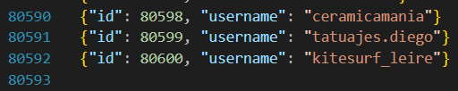
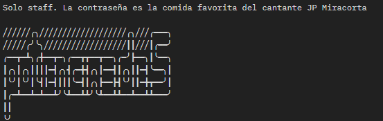

# Reto I. Puerto Rico — La Chocita

## Recursos base:
- Host: http://hpecds.comnetconsultores.cloud:7373/ 
- Api endpoints:
    - /api/users
    - /api/users/{id}
    - hay una api para follows solo para personal autorizado?


## Data scraping

Después de hacer scraping de los 80600 usuarios en */api/users*, notamos que faltaban 8


Identificamos a los 8 que faltaban: **1037, 21952, 32775, 42083, 60579, 78402, 78890, 79291**

## Decodfiicando headers

Al buscar cada uno de estos ids en */api/users/{id}*, percatamos que la response contenía un custom header adicional, que no se encuentra en las responses del mismo endpoint al consultar otros usuarios.
El header dice ```x-pase-staff : x/8;b64=XXXXXX``` donde la primer x es un numero del 1 al 8, y las 6 X del final son caracteres.\
Inferimos que el x/8 era el orden en el que debíamos concatenar los 6 caracetres del final, para después convertirlos a ascii pues estaban en base 64 (b64).

http://hpecds.comnetconsultores.cloud:7373/api/users/78402 -> 1/8   b64=L2xhLW
http://hpecds.comnetconsultores.cloud:7373/api/users/78890 -> 2/8   b64=Nob2Np
http://hpecds.comnetconsultores.cloud:7373/api/users/21952 -> 3/8   b64=dGEvYW
http://hpecds.comnetconsultores.cloud:7373/api/users/60579 -> 4/8   b64=NjZXNv
http://hpecds.comnetconsultores.cloud:7373/api/users/42083 -> 5/8   b64=LTdrMT
http://hpecds.comnetconsultores.cloud:7373/api/users/32775 -> 6/8   b64=A1bDdh
http://hpecds.comnetconsultores.cloud:7373/api/users/1037  -> 7/8   b64=MmF4cj
http://hpecds.comnetconsultores.cloud:7373/api/users/79291 -> 8/8   b64=V1emg=

base 64 text = L2xhLWNob2NpdGEvYWNjZXNvLTdrMTA1bDdhMmF4cjV1emg= \
test en ASCII = /la-chocita/acceso-7k105l7a2axr5uzh

Endpoint: http://hpecds.comnetconsultores.cloud:7373/la-chocita/acceso-7k105l7a2axr5uzh

## La comida favorita
El endpoint the */la-chocita/acceso-7k105l7a2axr5uzh* regresa el siguiente mensaje:


**potenciasde5** nos hizo pensar en que quizás la comida favorita está inscrita dentro de la misma response, pero uasndo las potencias de 5 como algún tipo de código, ya que en el statement del problema no encontramos nada de comida jaja.

Las porimeras potencias de 5 son : 1, 5, 25, 125, 625 ... Pero el texto solo tiene 73 caracteres, por lo que pensamos en aplicarles módulo 73 a estos números para quizás encontrar los índices de las letras que costituyan la comida favorita de JP Miracorta

PERO NOOOO, después de hacer un pequeño script en c++ para revisarlo, nunca daba algo coherente.

Así que recurrimos a la única otra información que tenemos: los users

hay 80600 users, y ahí caben bastantes potencias de 5, por lo que revisamos los users con id potencia de 5

http://hpecds.comnetconsultores.cloud:7373/api/users/1      -> noa.hernandez
http://hpecds.comnetconsultores.cloud:7373/api/users/5      -> marta.ruiz
http://hpecds.comnetconsultores.cloud:7373/api/users/25     -> olgaOrtiz
http://hpecds.comnetconsultores.cloud:7373/api/users/125    -> fabiola.lopez
http://hpecds.comnetconsultores.cloud:7373/api/users/625    -> ofelia.g
http://hpecds.comnetconsultores.cloud:7373/api/users/3125   -> noelia.medina
http://hpecds.comnetconsultores.cloud:7373/api/users/15625      -> gema.iglesias
http://hpecds.comnetconsultores.cloud:7373/api/users/1      -> olivia.perez

Y pues, pensando que es un acertijo, nos fijamos en las iniciales de los nombre y apellidos de las personas. Las iniciales de los nombres de todos nos daba: **nmofongo** y pues, no es un platillo, pero al investigar, **mofongo** sí es un platillo, incluso típico de puerto rico que es de donde se basa el reto. entonces ese es!!!

## Donde va la comida???

Intentamos poner un header ```password : mofongo```, ponerla en la api request como parámetro, poner "password", "contrasena", "contraseña", nada.

Entonces, nos fijamos de nuevo en los headers y vimos el www-authenticate : bearer realm "La Chocita", y pues, pusimos el header Authorization en la request, con valor Bearer mofongo, y funcionó
```
{
    "mensaje": "Bienvenido a La Chocita.",
    "follows": "/la-chocita/acceso-7k105l7a2axr5uzh/follows"
}
```

## Tenemos todos los follows, pero ahora?
Pues, hay que buscar un grupo de 5 a 10 personas, que todos se conozcan entre sí, y que a su vez, junten a la mayor cantidad de followers.

Si modelamos el problema como un grafo, donde cada nodo es un usuario y la arista de un usuario *u* a un usuario *v* representa que *u* es seguido por *v*, podemos buscar los cliques, o subgrafos completos dentro del grafo (grupos de personas que se conozcan todas entre sí)

Como tenemos 80600 nodos y 1204628 aristas, no conocemos algoritmo eficiente que pueda calcular todos los cliques.

Podemos, sin embargo, ir filtrando los nodos que tengan menos de 5 seguidos, porque si no tienen al menos 5 aristas (seguidos) no estarán dentro de un clique de al menos 5 nodos.